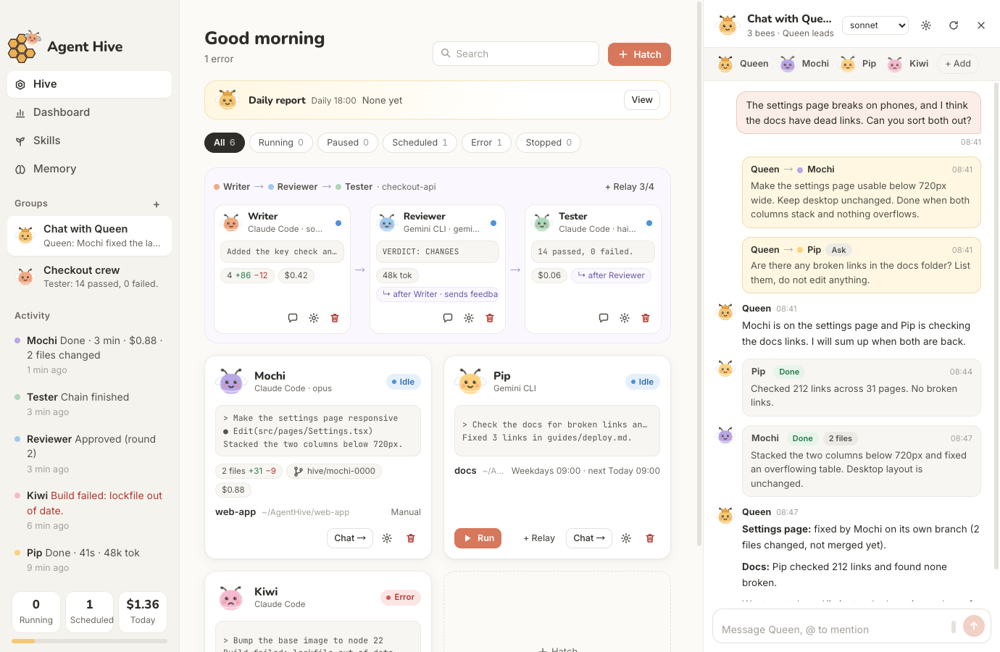

# Agent Hive

A macOS desktop app for running a hive of coding agents. Each **bee** is a coding-agent CLI (Claude Code, Codex, Gemini, Cursor Agent, or any command you like) working in its own folder. You hatch bees, give them work, and watch them from one place.



## Install

> **Not released yet.** The app is still being polished, so the installer below has nothing to download. For now, run it from source (see [Development](#development)).

```bash
curl -fsSL https://raw.githubusercontent.com/ericwang915/agent-hive/main/install.sh | bash
```

This downloads the latest release for your Mac (Apple silicon or Intel), puts `Agent Hive.app` in `/Applications` and opens it. You can also grab the `.dmg` from the [releases page](https://github.com/ericwang915/agent-hive/releases).

The app is not notarized by Apple. The install script clears the quarantine flag for you; if you install from the `.dmg`, right-click the app and choose **Open** the first time.

### Requirements

- macOS 12 or later
- At least one agent CLI on your `PATH`: [`claude`](https://docs.claude.com/en/docs/claude-code), `codex`, `gemini` or `cursor-agent`. Queen, the daily report and the night bees need `claude`.
- `git`, if you want diffs, commits, branches and PRs. `gh` is optional (used to open PRs).

Agent Hive does not ship or store any API keys. It runs the CLIs you already have, with whatever login they already use.

## What it does

- **Hive** – up to 40 bees, each a card with its recent output. Open any bee in its own chat window; send a message mid-run to interrupt and redirect it.
- **Schedules** – manual, once, daily, weekly, monthly or every N minutes. Runs missed while the Mac was asleep are caught up the same day.
- **Sleep-safe** – running bees stop when the lid closes and resume when it opens, and after an app restart.
- **Relay teams** – chain up to four bees in one folder: write → review → fix → test, or fan out in parallel git worktrees and merge the results.
- **Groups** – chat rooms you pull bees into. With **Queen** in the group, you say what you want and she picks bees, dispatches work, and sums up the results. Without her, your message goes to every member, or just the one you `@mention`.
- **Changes** – per-bee diff, commit, discard, push and open a PR. A bee can work on its own branch and worktree, then merge back.
- **Permissions** – ask each time (Claude Code permission prompts appear in the app), auto-accept edits, or allow all.
- **Spend** – cost and tokens per round, with a daily budget that pauses automatic runs.
- **Night bees** – *Dreamer* tidies long-term memory and *Gardener* distills reusable skills from the day's conversations. New sessions start with that context.
- **Dashboard** – activity timeline, spend, and Queen's daily report.

## Safety

Bees run real commands on your machine with the permission level you choose. "Allow all" skips every confirmation, so only use it in folders you trust.

The app listens on `127.0.0.1` on a random port, protected by a per-launch token, so that Claude Code can ask it for permission decisions and Queen can call her tools. Nothing is exposed to the network.

State lives in `~/Library/Application Support/Agent Hive/`. Workspaces, skills and memory live under `~/AgentHive/` by default.

## Development

```bash
git clone https://github.com/ericwang915/agent-hive.git
cd agent-hive
npm install
npm start        # run the app
npm test         # unit tests for the pure logic
npm run dist     # build the .zip and .dmg into dist/
```

There is no build step and no framework: plain HTML/CSS/JS in the renderer, Electron in the main process.

| File | Role |
|---|---|
| `main.js` | Main process: state, process management, scheduling, relay execution, git, approvals, groups and Queen, IPC |
| `core.js` | Pure logic: engines and command lines, schedule keys, output parsers, relay planning, git/worktree helpers |
| `team.js` | Relay-team graph helpers, shared by main and renderer |
| `queen.js` | Pure logic for groups: Queen's tools, dispatch rules, result parsing |
| `garden.js` | Skills and memory files, Dreamer/Gardener prompts |
| `approve-mcp.js`, `hive-mcp.js` | Tiny MCP stdio servers that call back into the app |
| `index.html`, `app.js` | Main window |
| `chat.html`, `chat.js` | Per-bee chat window |
| `common.js`, `style.css` | Shared helpers and styles |
| `test.js` | Unit tests |

Set `HIVE_DATA=/some/dir` to run against a throwaway state directory.

## License

[MIT](LICENSE)
