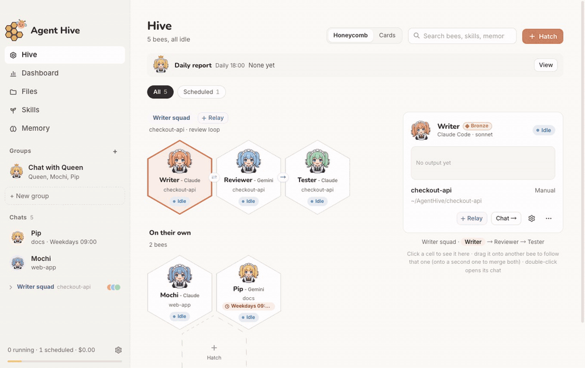
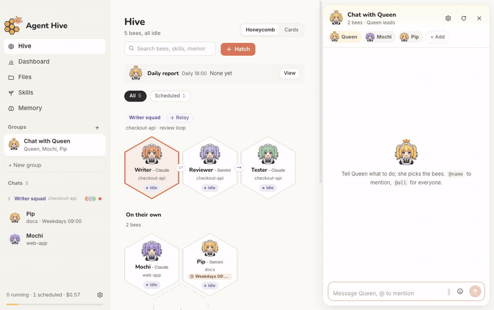
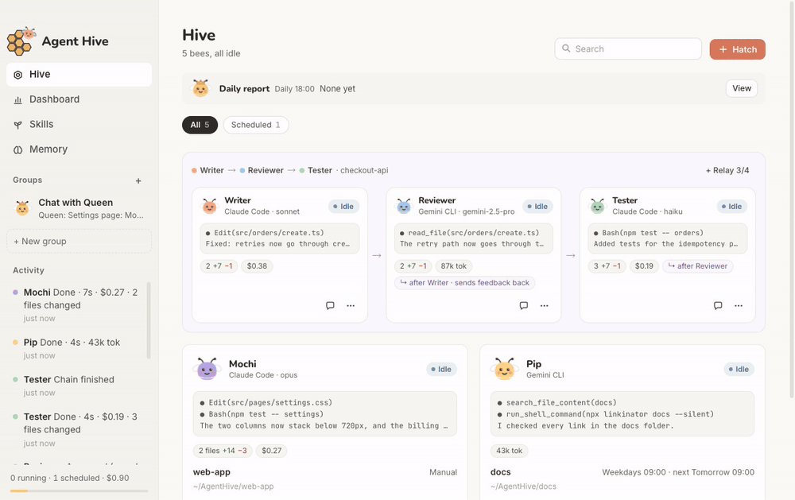

<p align="center"></p>
<h1 align="center">Agent Hive</h1>
<p align="center">Run a team of coding agents on your Mac, and see what every one of them is doing.</p>
<p align="center">
  <a href="https://github.com/ericwang915/agent-hive/actions/workflows/test.yml"></a>
  
  <a href="LICENSE"></a>
</p>



Each **bee** is a coding-agent CLI working in its own folder: Claude Code, Codex, Gemini, Cursor Agent, or any command you like. Agent Hive runs them side by side, on a schedule if you want, and lets them hand work to each other. It uses the CLIs and logins you already have. It ships no API keys and stores none.

## What you can do with it

### Let Queen lead a group

Pull bees into a group and tell Queen what you want. She picks the right bees, dispatches the work, waits for the results and sums them up. She only wakes the bees she needs, and she asks before hatching new ones.



A group works without Queen too. `@mention` a bee and it starts right away. Leave the name out and a small, cheap model picks the bee the message is for, so the others stay asleep; a bee with nothing to add stays quiet. Stickers work both ways. A bee can hand part of the job to another by `@mentioning` it, for at most three hops.

### Chain bees into a relay team

Up to four bees share a folder and pass work down the line. A reviewer can send its findings back to the writer until it approves, for at most three rounds. Bees on the same step run in parallel, each in its own git worktree, and a final bee merges their results. The clip at the top is one such team.

### Read every step, then review the diff

Each bee has its own chat window with the full conversation. Replies stream in as they are written, edits show as inline diffs, sub-agents are nested, and every round shows its cost. Type `@` to point at a file, `/` for commands, Shift-Tab to switch between Ask, Auto-edit and Plan. The bee's folder sits in a sidebar on the left, and file paths in the conversation are clickable: they open in a read-only viewer at the line mentioned. The Changes tab shows the diff. Commit, discard, push and open a pull request from there, or keep a bee on its own branch and merge when you are happy.


### Hatch a bee in a few clicks

Pick a folder, an engine and a model. Give it a prompt and a schedule, or leave both empty and just talk to it.



### And the rest

- **Schedules.** Once, daily, weekly, monthly, or every N minutes. Runs missed while the Mac slept are caught up the same day.
- **Sleep-safe.** Running bees stop when the lid closes and pick up where they left off when it opens, or when the app restarts.
- **Permissions.** Approve each action from the app (Claude Code), auto-accept edits, allow everything, or plan first and change nothing. Switch at any time from the chat.
- **Context.** A meter shows how full a Claude Code bee's session is. `/compact` summarises it on the spot, and `/new` starts over.
- **Token savers.** A session that is half full, or large and idle for an hour, is compacted before its next round. Scheduled runs start a new session. A bee can leave out your MCP servers. Reports and the night bees use a smaller model. All adjustable.
- **Spend.** Cost and tokens per round, and a daily budget that holds back automatic runs once it is used up.
- **Memory and skills.** Overnight, *Dreamer* tidies long-term memory and *Gardener* turns the day's conversations into reusable skills. New sessions start with both.
- **Dashboard.** A 24-hour activity timeline, spend, and Queen's daily report.
- **Upgrades.** When a newer release is out, an Upgrade button appears in the sidebar. It downloads the release, checks that it is signed by the same developer, swaps the app and restarts.
- **Right-click anything.** Rename, settings, stop and delete for bees and groups.

## Install

```bash
curl -fsSL https://raw.githubusercontent.com/ericwang915/agent-hive/main/install.sh | bash
```

This downloads the latest release for your Mac (Apple silicon or Intel), puts `Agent Hive.app` in `/Applications` and opens it. You can also download the `.dmg` from the [releases page](https://github.com/ericwang915/agent-hive/releases). The app is signed and notarized by Apple.

To run from source instead:

```bash
git clone https://github.com/ericwang915/agent-hive.git
cd agent-hive
npm install
npm start
```

### Requirements

- macOS 12 or later
- At least one agent CLI on your `PATH`: [`claude`](https://docs.claude.com/en/docs/claude-code), `codex`, `gemini` or `cursor-agent`. Queen, the daily report and the night bees need `claude`.
- `git` for diffs, commits, branches and pull requests. `gh` is optional and used to open pull requests.

## Safety

Bees run real commands on your machine, with the permission level you choose. "Allow all" skips every confirmation, so only use it in folders you trust.

The app listens on `127.0.0.1` on a random port, protected by a per-launch token. Claude Code uses it to ask for permission decisions, and Queen uses it to call her tools. Nothing is exposed to the network.

State lives in `~/Library/Application Support/Agent Hive/`. Workspaces, skills and memory live under `~/AgentHive/` by default.

## How it is built

No build step and no framework: plain HTML, CSS and JS in the renderer, Electron in the main process, two small dependencies for Markdown.

| File | Role |
|---|---|
| `main.js` | Main process: state, process management, scheduling, relay execution, git, approvals, groups and Queen |
| `core.js` | Engines and command lines, schedule keys, output parsers, relay planning, git and worktree helpers |
| `team.js` | Relay-team graph helpers, shared by main and renderer |
| `queen.js` | Queen's tools, dispatch rules and result parsing |
| `garden.js` | Skills and memory files, Dreamer and Gardener prompts |
| `update.js` | Upgrade: finding, downloading, verifying and installing a newer release |
| `files.js` | File browser: listing, reading and locating paths inside a bee's folder |
| `approve-mcp.js`, `hive-mcp.js` | Small MCP stdio servers that call back into the app |
| `index.html`, `app.js` | Main window |
| `chat.html`, `chat.js` | Per-bee chat window |
| `test.js` | Unit tests for everything that does not need Electron |

```bash
npm test             # unit tests
npm run dist         # build an ad-hoc signed .zip and .dmg into dist/
npm run dist:signed  # the same, signed and notarized (needs CSC_NAME and NOTARYTOOL_PROFILE)
```

## Contributing

Issues and pull requests are welcome. See [CONTRIBUTING.md](CONTRIBUTING.md) for how the code is laid out and how to add an engine.

## License

[MIT](LICENSE)
