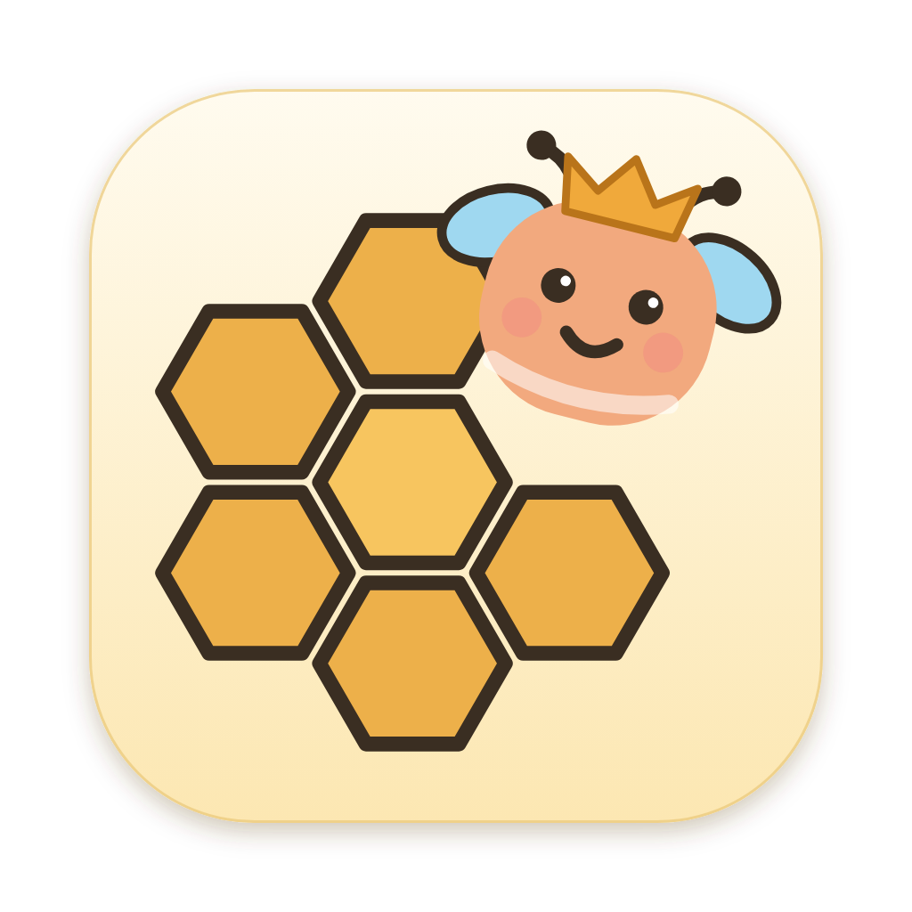
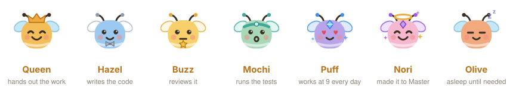
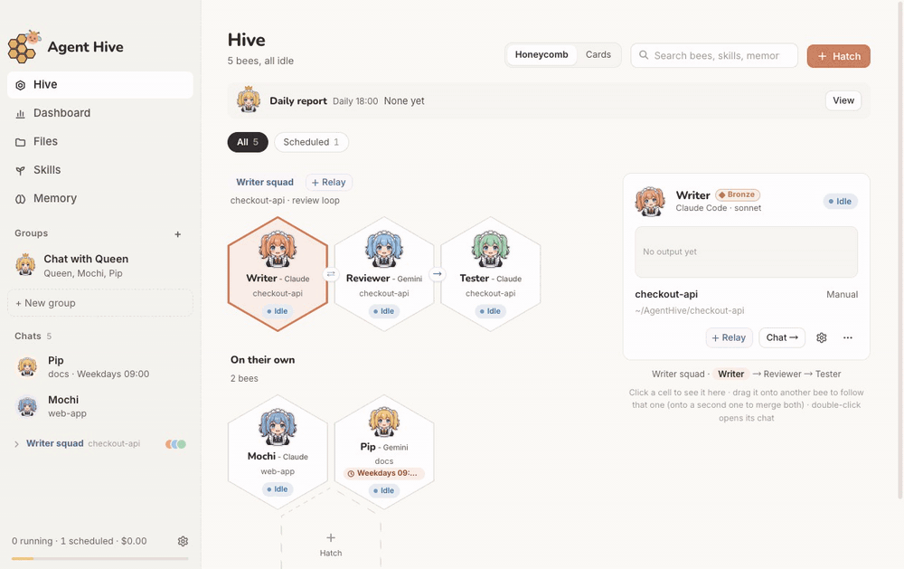
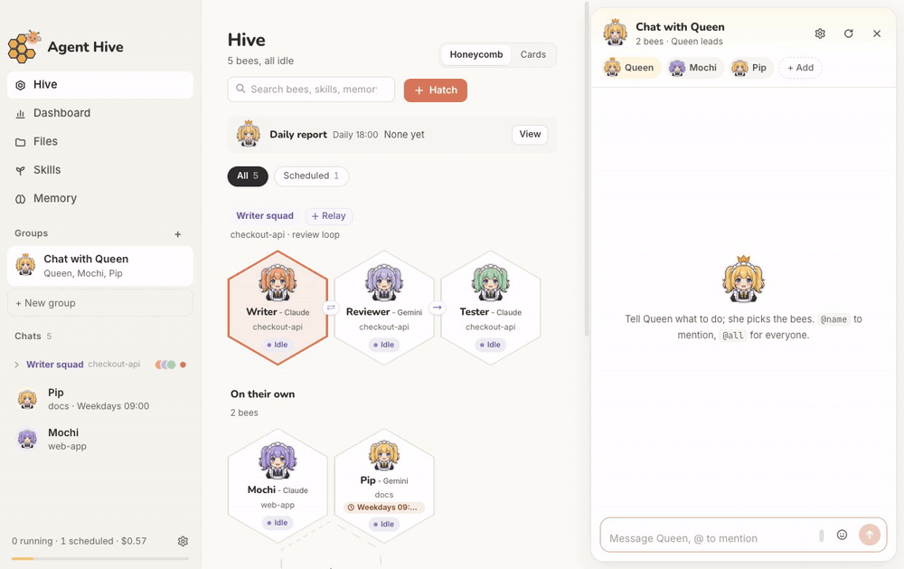
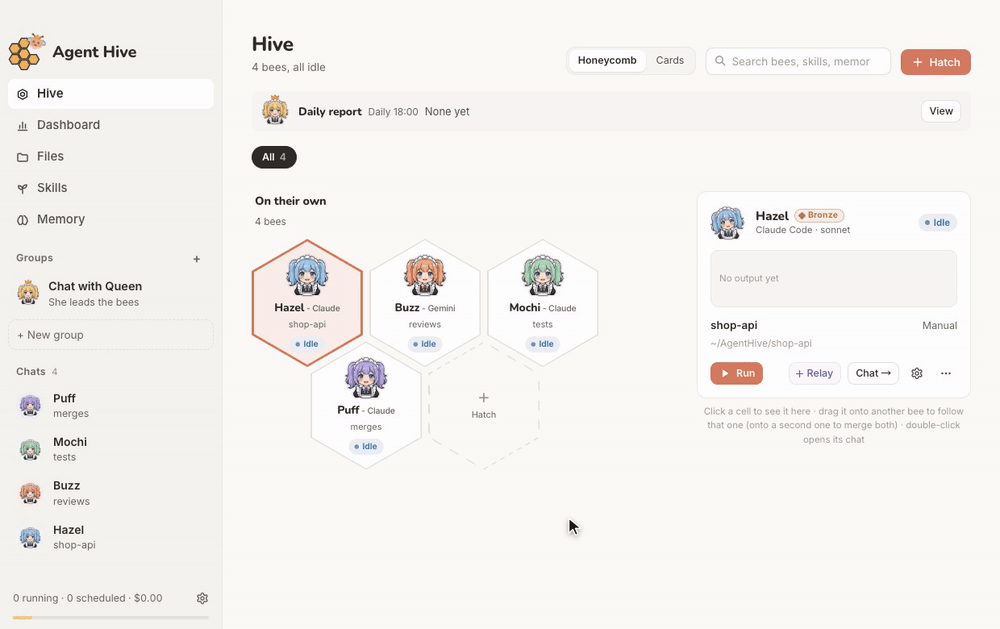
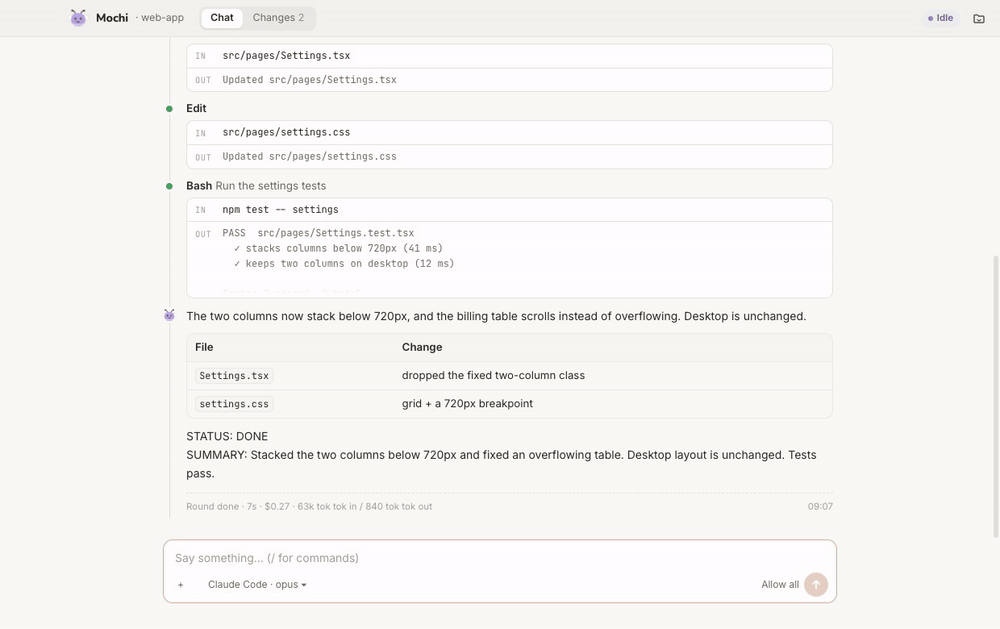
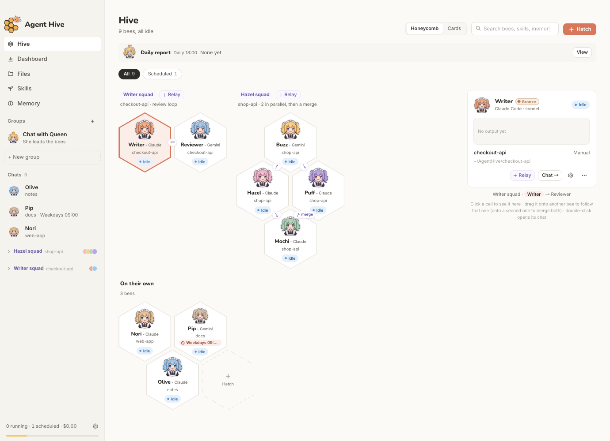
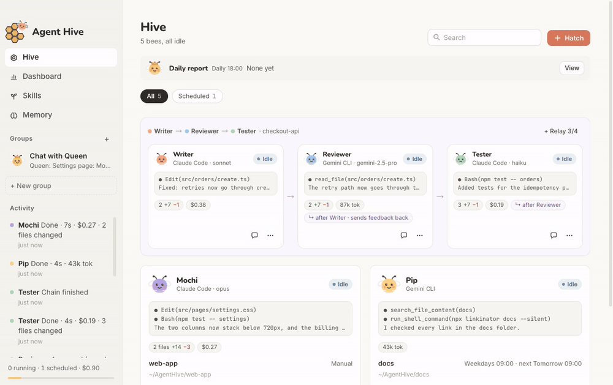

<p align="center"></p>
<h1 align="center">Agent Hive 🐝</h1>
<p align="center"><b>一只蜂后，一群蜜蜂。让你的编程 agent 像蜂群一样协作。</b><br>
免费、开源的 Mac 应用，把 Claude Code、Codex、Gemini CLI、Antigravity、DeepSeek Harness 和 Cursor Agent<br>变成一支看得见、能定时、可指挥的小团队。</p>
<p align="center">
  <a href="https://github.com/ericwang915/agent-hive/releases/latest"></a>
  <a href="https://github.com/ericwang915/agent-hive/releases"></a>
  <a href="https://github.com/ericwang915/agent-hive/stargazers"></a>
  
  <a href="LICENSE"></a>
</p>
<p align="center">
  <a href="https://github.com/ericwang915/agent-hive/releases/latest"><b>⬇️ 下载 Mac 版</b></a> · <a href="#安装">安装</a> · <a href="#能用它做什么">功能</a> · <a href="#常见问题">常见问题</a> · <a href="README.md">English</a>
</p>

<p align="center"></p>

<p align="center"><i>每个 agent 都是一只有名字、有表情、有分工的蜜蜂。干活时上下浮动，闲下来打瞌睡，<br>从青铜一路升到大师，每升一级换一个造型。</i></p>



<p align="center">如果这些蜜蜂让你笑了，点个 ⭐ 能让更多人找到这个蜂巢。</p>

## Agent Hive 是什么？

Agent Hive 是一个 macOS 应用，可以同时运行多个编程 agent 的命令行工具，并让它们组队协作。每个 agent 是一只**蜜蜂**：Claude Code、Codex、Gemini CLI、Antigravity（`agy`）、DeepSeek Harness（`dsh`）、Cursor Agent，或者任何你喜欢的命令，各自在自己的文件夹里工作。你可以单独和每只蜜蜂对话，给它设定时任务，把几只串成接力（一只写、一只审），或者拉进一个群，让 **Queen（蜂后）**来分派工作。

它用的是你电脑上已经装好、已经登录的 CLI，包括 Claude 或 ChatGPT 的订阅。应用本身不带 API key，不保存 key，不需要注册账号，也没有自己的服务器。

## 亮点

- 🐝 **任何 agent，混编成一队。** Claude Code 写，Codex 审，Gemini 测。任何能接收提示词的命令行工具都可以当蜜蜂。
- 🌙 **你不在的时候它们照常干活。** 定时任务（一次、每天、工作日、周末、每周、每月、每 N 分钟）和事件触发（新提交、GitHub 的 PR、评论和 CI 失败、另一只蜜蜂完成），电脑睡眠时错过的任务会补跑，每日预算用完后自动任务会停下。
- 👑 **一个领队，代替十个终端窗口。** 告诉 Queen 你要什么，她挑选蜜蜂、分派任务、等结果、给你汇总。
- 🔁 **评审就在流程里。** 接力小队最多六只蜜蜂，评审者把意见退回给作者，直到通过为止。把一只蜜蜂拖到另一只上就能组队。每只蜜蜂都有 diff 视图，可以提交、推送、开 PR。
- 🗂️ **所有产出集中在一处。** Files 页面按蜜蜂和项目列出它们生成的每个 PDF、幻灯片、图表和链接。搜索可以找到蜜蜂、技能、记忆，以及任何一次对话里说过的话。
- 🍯 **比直接用 CLI 更省 token。** 会话在变贵之前自动压缩，定时任务每次从新会话开始，用不到的工具和 MCP 服务器不加载。在一次实测的三轮任务里，同一台机器、同样配置下，每轮携带的上下文比直接用 `claude -p` 少约 30%（2.9 万对 4.4 万 token）。
- 🧠 **它会记住。** 每天夜里，两只帮手蜜蜂把当天的对话整理成长期记忆和可复用的技能，新会话开始时自动带上。
- 🔒 **只需要信任你自己的电脑。** MIT 许可，无构建步骤，无遥测；应用自己发出的唯一请求是到 GitHub 检查新版本。应用经过 Apple 签名和公证，可以自动升级。

## 安装

```bash
curl -fsSL https://raw.githubusercontent.com/ericwang915/agent-hive/main/install.sh | bash
```

这条命令会下载适合你 Mac 的最新版本（Apple 芯片或 Intel），把 `Agent Hive.app` 放进 `/Applications` 并打开。

用 Homebrew 安装：

```bash
brew install --cask ericwang915/tap/agent-hive
```

也可以从[发布页](https://github.com/ericwang915/agent-hive/releases)下载 `.dmg`。应用经过 Apple 签名和公证。

从源码运行：

```bash
git clone https://github.com/ericwang915/agent-hive.git
cd agent-hive
npm install
npm start
```

### 环境要求

- macOS 12 或更高版本
- `PATH` 里至少有一个 agent CLI：[`claude`](https://docs.claude.com/en/docs/claude-code)、`codex`、`gemini`、`agy`、`dsh`，或 Cursor 的 `agent`（旧版本叫 `cursor-agent`）。Queen、每日报告和夜间蜜蜂会用这些 CLI 里能用的那个：优先 Claude Code，不行就自动换下一个能应答的。装了但用不了的 CLI（比如没登录）会被跳过。
- `git`：用于 diff、提交、分支和 PR。`gh` 可选，用来开 PR。

## 能用它做什么

### 让 Queen 带一个群

把蜜蜂拉进一个群，告诉 Queen 你要什么。她会挑合适的蜜蜂、分派任务、等待结果并汇总。她只叫醒需要的蜜蜂，要孵化新蜜蜂时会先问你。



没有 Queen 的群也能用。`@` 一只蜜蜂，它马上开始。不写名字的话，一个便宜的小模型会判断这条消息该给谁，其他蜜蜂继续睡；没话可说的蜜蜂保持安静。蜜蜂之间也可以互相 `@` 来转交工作，最多三跳。

### 把蜜蜂串成接力小队

最多六只蜜蜂共用一个文件夹，把工作一棒一棒往下传。评审者可以把意见退回给作者，直到通过为止，最多三轮。交接可以带条件：在 "Only when" 里用一句话写清楚（比如“转化率低于 5%”“测试有失败”），上一只跑完后由一次小的模型调用对照它的回复判断，不满足就不交接，并在聊天里说明依据。同一步的蜜蜂并行工作，各自在自己的 git worktree 里，最后由一只蜜蜂合并结果。蜂巢里已有的蜜蜂也能加入小队（它会搬进小队的文件夹，离开时回到自己的），两只蜜蜂之间的连接可以单独去掉，不用删除任何一只。

**拖一拖就能搭好。** 把一只蜜蜂拖到它要跟随的蜜蜂上。两只都拖到同一只上，它们就并行；再把一只拖到第二只上，它会等两边都完成后合并。



接力小队也是一个有名字的 **squad**。Queen 可以一次把整件事交给它，等整条链完成或卡住时才收到一次回报。你也可以在任何群里自己启动它：`@Shop-squad 加一个导出按钮`。

### 看清每一步，再审 diff

每只蜜蜂有自己的聊天窗口，保留完整对话。回复边写边显示，修改以行内 diff 展示，子 agent 嵌套显示，每一轮都标出花费。输入 `@` 指向文件，`/` 调出命令，Shift-Tab 在询问、自动编辑和计划模式之间切换。左侧是蜜蜂的文件夹，对话里的文件路径可以点击，直接打开到提到的那一行。Files 标签是一个小编辑器，Media 标签把文件夹里的图片、文档、网页、视频和音频集中在一起，按时间从新到旧排列，点开就能预览，Changes 标签显示 diff。按 ⌃`（或菜单栏 View → Terminal）在对话下方打开终端面板：shell 就在蜜蜂的文件夹里，可以开多个，选中的输出能一键放进输入框。



### 一眼看到整个蜂巢

Hive 页面默认是蜂巢视图，也可以切回经典的卡片视图。每支小队是一簇格子，形状跟着接力关系走：直链排成一行，评审循环标在共用的边上，并行的蜜蜂散开，到合并处再汇合。点一个格子，它的完整卡片和所有按钮显示在蜂巢旁边。把一只蜜蜂拖到另一只上，它就加入那只的小队；点连接上的小标记可以去掉这条连接。



### 几下点击孵化一只蜜蜂

选一个文件夹和一个引擎。给它提示词和定时，或者都留空，直接和它聊。蜜蜂默认使用 CLI 的默认模型，聊天框下面的模型按钮随时可以换。



### 还有这些

- **定时。** 一次、每天、每周、每月或每 N 分钟。电脑睡眠时错过的任务当天补跑。
- **事件触发。** 蜜蜂可以等一件事发生再开工：分支上有新提交、GitHub 事件（新 PR、新评论、CI 失败）、另一只蜜蜂完成或失败。
- **睡眠安全。** 合上盖子时运行中的蜜蜂会停下，打开后或应用重启后从原处继续。
- **权限。** 每个操作在应用里审批（Claude Code）、自动接受编辑、全部允许，或只做计划不改动。聊天中随时切换。
- **用你自己的 Chrome。** Claude Code 蜜蜂可以在你已登录的 Chrome 里打开网页、点击、填表、读控制台。在蜜蜂设置里打开 "Use my Chrome"，需要安装 [Claude in Chrome](https://claude.ai/chrome) 扩展。
- **上下文。** 一个仪表显示 Claude Code 蜜蜂的会话有多满。`/compact` 当场压缩，`/new` 重新开始。
- **花费。** 每轮的费用和 token，以及一个每日预算，用完后自动任务暂停。
- **记忆与技能。** 夜里 *Dreamer* 整理长期记忆，*Gardener* 把当天的对话变成可复用的技能。记忆是分层的：蜜蜂说过的话存成事实，事实汇成观察，新会话拿到的记忆页由印证次数最多的观察生成。Memory 页上每一条都标着印证次数，点开能看到它依据的原话并跳到那段对话。被纠正的条目标为“已取代”保留下来，不会被悄悄改掉；你自己写的条目不会被改动；点 "This is wrong" 可以彻底拿掉一条。搜索覆盖学到的全部内容，包括没上记忆页的。
- **仪表盘。** 24 小时活动时间线、花费和 Queen 的每日报告。
- **升级。** 有新版本时侧栏会出现 Upgrade 按钮：下载、验证签名、替换并重启。
- **等级。** 每完成一轮都算数。蜜蜂从青铜、白银、黄金、铂金、钻石升到大师，每一级造型都不同。
- **搜索一切。** 搜索框和 ⌘K 可以找到蜜蜂、技能、记忆，以及任何对话或群里说过的话。

## 和其他工具的区别

并行运行编程 agent 的好工具有好几个，侧重点各不相同。以下是 2026 年 11 月 Agent Hive 的看法，各项目的最新功能请以它们自己的说明为准。

| 工具 | 核心思路 | 适合的场景 |
|---|---|---|
| **Agent Hive** | 一支常驻团队：定时 agent、领队（Queen）、带评审循环的接力小队、记忆和技能。开源，macOS。 | 你想让 agent 按计划持续工作、互相交接，并在一个窗口里统一看管。 |
| [Conductor](https://www.conductor.build) | 并行工作区，每个 agent 一个 git worktree。闭源的 macOS 应用。 | 你想在一个仓库上同时开很多独立任务，再逐个分支审查。 |
| [Claude Squad](https://github.com/smtg-ai/claude-squad) | 基于 tmux 的终端界面，每个 agent 一个 git worktree。开源。 | 你习惯待在终端里，希望关掉窗口后会话还在。 |
| [Vibe Kanban](https://github.com/BloopAI/vibe-kanban) | 看板上的任务由 agent 在工作区里领取。开源。 | 你习惯按工单思考，希望以看板为主视图。 |
| Claude Code agent teams | 多个 Claude Code 实例互相发消息。仅限 Claude。 | 你只用 Claude Code，想让它把一个任务拆给队友。 |

## 安全

蜜蜂会在你的电脑上按你选择的权限级别执行真实命令。"全部允许"会跳过所有确认，只应在你信任的文件夹里使用。

应用监听 `127.0.0.1` 上的一个随机端口，每次启动使用不同的令牌保护，不对网络开放。

状态保存在 `~/Library/Application Support/Agent Hive/`。工作区、技能和记忆默认在 `~/AgentHive/` 下。

## 常见问题

### Agent Hive 免费吗？

免费。它以 MIT 许可开源。你只需要为自己已经在用的 agent CLI 付费，通过它们各自的订阅或 API 计费。

### 需要 API key 吗？

不需要。Agent Hive 启动的是你 Mac 上已安装的 CLI，使用它们已有的登录状态，不保存任何 key。

### 能用 Claude Pro / Max 或 ChatGPT Plus 订阅吗？

能。只要 CLI 在你的终端里能用，它就能当蜜蜂，账号和额度都一样。

### 支持哪些编程 agent？

开箱支持 Claude Code、Codex CLI、Gemini CLI、Antigravity（`agy`）、DeepSeek Harness（`dsh`）和 Cursor Agent，另外支持任何接受提示词的命令行（带 `{prompt}` 的自定义模板）。Queen、每日报告和夜间蜜蜂会用这些 CLI 里能用的那个：优先 Claude Code，不行就自动换下一个能应答的。装了但用不了的 CLI（比如没登录）会被跳过。在群设置里也可以给 Queen 指定 CLI 和模型。

### 我的代码会离开我的电脑吗？

Agent Hive 没有服务器，不会把你的代码发到任何地方。各 agent CLI 和它们自己的服务商通信，和在终端里使用时完全一样。

### 支持 Windows 或 Linux 吗？

暂时不支持。目前针对 macOS 12 及以上版本构建和测试，支持 Apple 芯片和 Intel。

### 怎么更新？

有新版本时侧栏会出现 Upgrade 按钮。设置里也可以开启在没有蜜蜂工作时自动安装新版本。

## 参与贡献

欢迎提 issue 和 PR，也欢迎点 star：这是其他人找到这个蜂巢的方式。🐝 代码结构和如何添加新引擎见 [CONTRIBUTING.md](CONTRIBUTING.md)。完整的技术说明见[英文 README](README.md#how-it-is-built)。

## 许可

[MIT](LICENSE)
